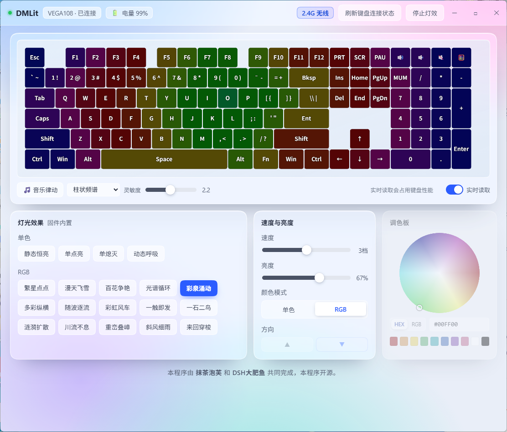

# DMLit

**中文** | [English](README_EN.md)

WEIKAV VEGA108 键盘灯效工具。有线 / 2.4G 无线都能用，支持实时读色、固件灯效、音乐律动和本地预览。



## 功能

- **固件灯效**：静态恒亮 / 单点亮 / 单熄灭 / 动态呼吸 / 繁星点点 / 漫天飞雪 / 百花争艳 / 光谱循环 / 彩泉涌动 / 多彩纵横 / 随波逐流 / 彩虹风车 / 一触即发 / 一石二鸟 / 涟漪扩散 / 川流不息 / 重峦叠嶂 / 斜风细雨 / 来回穿梭
- **音乐律动**：采集系统输出音频，柱状频谱 / 块状火山 / 彩虹波 / RGB 脉冲
- **实时读色**：读取键盘当前逐灯颜色并预览（有线 cmd 51，无线 cmd 59）
- **电量显示**：有线 / 无线都能读
- **单键改色**：切到「自定义」后先选颜色、再点键帽逐键上色；支持全选 / WASD / 数字键 / 方向键批量上色（键盘 20 号模式，`SET_CUSTOM_LED_DATA` 持久写入，不会几秒后回滚）
- **单键改键**：点「改键」，在键盘图上选键、再从键码表里选新功能，直接写进键盘（`SET_KEY=34` 全表写，`GET_KEY=18` 读回）
- **颜色、亮度、速度、方向**调节
- **状态记忆**：退出时的灯效、颜色、亮度等保存在 `state.json`，下次启动自动恢复
- **启动画面**、毛玻璃界面风格
- 有线 / 2.4G 无线自动识别，顶栏显示连接方式
- **托盘常驻**：关窗口不退出，收进托盘继续跑；托盘菜单可显示窗口 / 切换开机自启 / 退出
- **开机自启**：默认开启，托盘菜单里可随时关闭
- **收进托盘或最小化时自动暂停**：实时读取和界面重绘（30fps 轮询 + 预览重绘）一起停，后台 CPU 从约 12% 降到 0.2% 以内，窗口回来自动恢复

## 更新日志

各版本改动见 [CHANGELOG.md](CHANGELOG.md)。

## 下载

不想装 Python 的，直接下 **DMLit.exe** 双击即可运行：

- [Gitee Releases](https://gitee.com/Anran512/dmlit/releases/latest)
- [GitHub Releases](https://github.com/MoChaPF/DMLit/releases)（同步发布）

## 仓库

- Gitee：https://gitee.com/Anran512/dmlit （主仓库）
- GitHub：https://github.com/MoChaPF/DMLit （镜像）

## 环境要求

- Windows 10 / 11
- Python 3.8+
- WebView2 运行时（Win10/11 一般自带）

## 安装与运行

```bash
pip install -r requirements.txt
```

然后双击 `启动.bat`，或者命令行：

```bash
python app.py
```

## 使用说明

- 插线（有线）或插 2.4G 接收器都能用，顶栏会显示「有线连接」或「2.4G 无线」
- 拔插设备后点「刷新键盘连接状态」重新识别
- **实时读取会占用键盘性能**，不需要看实时颜色时建议关掉
- 音乐律动开着时，速度和亮度、调色板会锁定（由软件接管）
- 单键改色：点「自定义」进入，**先在调色板选颜色，再点键帽上色**；批量改色可勾选全选 / WASD / 数字键 / 方向键，再点颜色整组生效
- 单键改键：点「改键」进入，先点键盘上的键、再从键码表选新功能。**Fn 键（`0xAF`）是固件特殊键，别改**，改掉之后所有 Fn 组合都会失效
- 关掉本程序后，键盘回到自带灯效

## 文件说明

| 文件 | 说明 |
|---|---|
| `app.py` | 主程序（HID 通信、灯效引擎、音乐分析、WebView 桥） |
| `index.html` | 界面（HTML/CSS/JS） |
| `vega108_layout.json` | 键位布局（6 行 / 106 键，含 LED 编号与键名） |
| `splash.png` | 启动画面 |
| `启动.bat` | Windows 一键启动 |
| `state.json` | 运行时生成，记录上次灯效设置 |

## 协议要点

逆向自厂商网页驱动，要点如下：

- 帧头 `0xAA`，响应头 `0x55`；命令：`GET_LED_EFFECT=19`、`SET_LED_EFFECT=35`、`SET_CUSTOM_LED_DATA=36`、`GET_ALL_LIGHTS_RGB=51`
- 无线（2.4G，usagePage `0xFF60`）另有专用命令：`GET_ALL_LIGHTS_RGB_24G_64_BYTE=59`（读色 + 电量）、`SET_MUSIC_DATA_24G_64_BYTE=60`（推灯）
- 固件灯效必须带 `driverSetting=255`，否则无线通道会丢弃整包
- 单键改色走键盘 **20 号模式**（固件里叫「自定义」），数据用 `SET_CUSTOM_LED_DATA=36`，512 字节 = 128 灯 × `[ledId, r, g, b]`。走临时数据（cmd 50）几秒后会被固件动画覆盖，所以必须用 36 写持久数据
- 改键：`SET_KEY=34` 全表写（512 字节 = 128 键 × `[pageType, p1, p2, p3]`），`GET_KEY=18` 读取；读命令的回包是自定义帧头 `AA 12 04 addrLo addrHi 00 00 00`，数据在 `r[8..11]`。解析时要跳过 `cmd=51` 的 RGB 噪声包

## 已知限制

- 无线通道读模式（`cmd 19`）会长时间超时，程序跳过不读，灯效按钮靠保存状态回填
- 部分固件版本的模式表可能不同，个别效果可能不生效
- 自绘全帧刷新受 USB 端点限制，固件灯效零带宽最流畅

## 适配其他键盘

本工具目前只适配 VEGA108。想移植到别的键盘，看 **[docs/适配指南.md](docs/适配指南.md)** —— 写给接手的 AI 助手：协议逆向方法、代码地图、10 步检查清单、已知的坑。

## 用 AI 助手来改这个项目

这个项目本身就是 AI 助手（我们内部叫它「大肥鱼」）在对话里从零写出来的。想复刻同样的干活方式，按下面来。

### 需要什么

| 需要 | 说明 |
|---|---|
| **DeepSeek Harness（DSH）** | 桌面 AI 编程客户端，自带文件读写和命令执行。没有它 AI 只能给你贴代码，改不了本地文件 |
| **长期记忆插件**（可选） | `dsh-plugin-memory`，让 AI 记住项目背景和踩过的坑，不用每次从零解释 |
| **不需要** | 不需要额外的灯效/键盘插件，协议逆向这部分 AI 自己抓包就能做 |

读写文件、跑命令、联网查资料这些能力 DSH 自带，**不用装插件**。

### 插件清单（直接复制给 AI）

```
帮我装这个 DSH 插件，装完告诉我需不需要重启：
dsh-plugin-memory —— 长期记忆插件，用来记住这个项目的背景、协议结论和踩过的坑

如果插件市场里搜不到，就用 npm 包名 dsh-plugin-memory 安装。
装完后按这份仓库的 docs/适配指南.md 帮我改 DMLit。
```

### 把项目交给它

1. 把仓库整个目录下载到本地（含 `app.py`、`index.html`、`docs/`、`vega108_layout.json`）
2. 在 DSH 里把这个目录设成工作目录
3. 开一个新对话，把下面这段直接复制给它：

```
读 docs/适配指南.md 和 docs/键盘手册.md，然后读 app.py 的 Keyboard 类和 Api 类。
我要把 DMLit 适配到 <你的键盘型号>。
按指南里的 10 步检查清单走，每一步验证通过后再继续。
协议结论必须有抓包或实测支撑，不要凭常理推测。
```

### 它会怎么干

1. 先判断你这把键盘**能不能适配**（是不是 QMK/VIA、有没有官方网页驱动）
2. 让你在浏览器里打开官方驱动，注入钩子抓 HID 包
3. 拿到命令号后写最小脚本验证
4. 改 `app.py` 的常量、改 `index.html` 的按钮和键码表
5. 每改一处就让你测一次

### 给使用者的三条提醒

- **别让它跳过抓包直接写代码**，那样写出来的一定是猜的
- **每改一处就验证一次**，别攒一堆改动最后一起炸
- **协议不明就让它停下问你**，宁可慢也别瞎试

## 许可

本项目基于 [MIT License](LICENSE) 开源。

## 致谢

- 界面字体：Noto Sans SC（SIL OFL 1.1）
- 启动画面：鲸鱼娘形象来自 [蓝色大肥鱼档案馆](https://fisharchive.cc/)，**CC BY-NC-SA 4.0**
- 其他第三方资源详见 [CREDITS.md](CREDITS.md)

---

本程序由 **抹茶泡芙** 和 **DSH大肥鱼** 共同完成，本程序开源。
