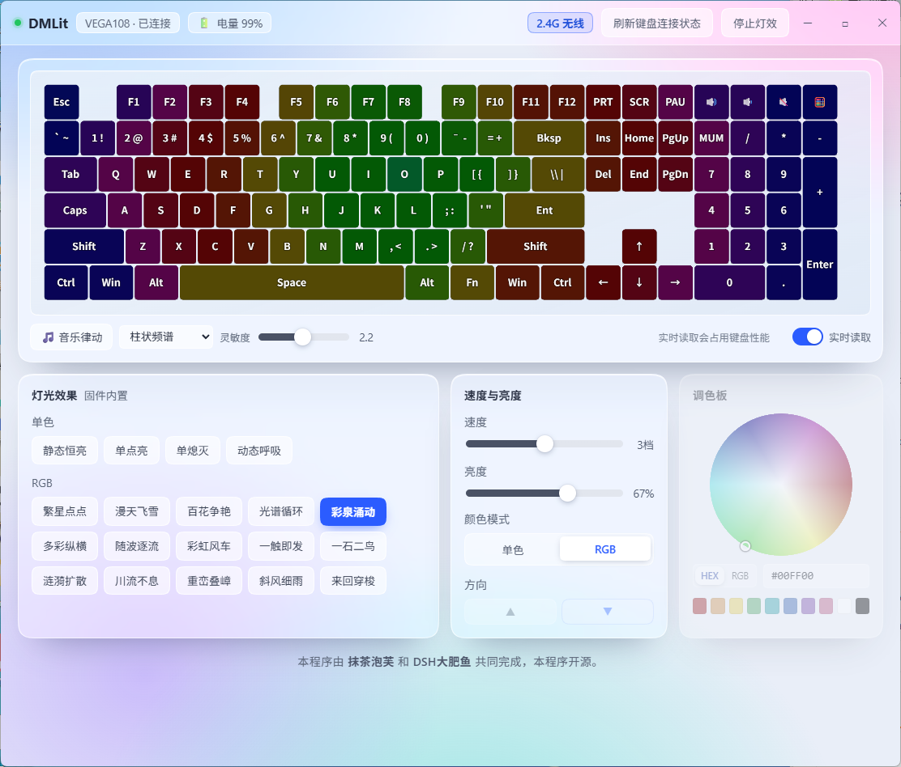

# DMLit

[中文](README.md) | **English**

Lighting control tool for the **WEIKAV VEGA108** keyboard. Works over USB and 2.4G wireless, with real-time color readback, firmware effects, music-reactive lighting and a live preview.



## Features

- **Firmware effects** (19): solid, single-key glow, single-key fade, breathing, starfield, snowfall, blooming, spectrum cycle, colorful spring, multicolor, wave flow, rainbow windmill, touch trigger, one stone two birds, ripple spread, endless flow, layered peaks, slanting rain, ping-pong
- **Music reactive**: captures system audio, four modes (bars / volcano / rainbow / RGB pulse)
- **Real-time color readback**: reads per-key colors (USB `cmd 51`, wireless `cmd 59`)
- **Battery level**: works on both USB and 2.4G
- Color, brightness, speed and direction controls
- **State memory**: saves the last effect/color/brightness to `state.json` and restores it on launch
- Splash screen, Liquid Glass style UI
- Auto-detects USB / 2.4G and shows the connection type
- **System tray**: closing the window keeps it running in the tray
- **Launch on startup**: enabled by default, toggle from the tray menu
- Real-time readback is paused while minimized to the tray

## Download

Grab **DMLit.exe** and double-click — no Python required:

- [Gitee Releases](https://gitee.com/Anran512/dmlit/releases/latest)
- [GitHub Releases](https://github.com/MoChaPF/DMLit/releases)

## Repositories

- Gitee (primary): https://gitee.com/Anran512/dmlit
- GitHub (mirror): https://github.com/MoChaPF/DMLit

## Requirements (running from source)

- Windows 10 / 11
- Python 3.8+
- WebView2 runtime (bundled with Win10/11 in most cases)

## Install and run

```bash
pip install -r requirements.txt
```

Then double-click `启动.bat`, or:

```bash
python app.py
```

## Usage

- Works over USB or with the 2.4G dongle; the status bar shows `有线连接` (USB) or `2.4G 无线` (wireless)
- After plugging/unplugging, click **刷新键盘连接状态** to re-detect
- **Real-time readback uses keyboard bandwidth** — turn it off when you don't need live colors
- While music mode is on, speed/brightness and the color palette are locked (the software takes over)
- Closing the app returns the keyboard to its built-in lighting

## Files

| File | Description |
|---|---|
| `app.py` | Main program (HID, effect engines, audio analysis, WebView bridge) |
| `index.html` | UI (HTML/CSS/JS) |
| `vega108_layout.json` | Key layout (6 rows / 106 keys with LED ids) |
| `splash.png` | Splash screen image |
| `启动.bat` | Windows launcher |
| `state.json` | Generated at runtime, stores the last settings |

## Protocol notes

Reverse-engineered from the vendor's web driver:

- Frame header `0xAA`, response header `0x55`; commands: `GET_LED_EFFECT=19`, `SET_LED_EFFECT=35`, `SET_CUSTOM_LED_DATA=36`, `GET_ALL_LIGHTS_RGB=51`
- Wireless (2.4G, usagePage `0xFF60`) has its own command subset: `GET_ALL_LIGHTS_RGB_24G_64_BYTE=59` (colors + battery), `SET_MUSIC_DATA_24G_64_BYTE=60` (push frames)
- Firmware effects must include `driverSetting=255`, otherwise the wireless channel drops the whole packet

## Known limitations

- Reading the current effect (`cmd 19`) blocks for a long time on wireless; the app skips it and relies on saved state
- Effect tables may differ between firmware revisions
- Software-driven full-frame updates are limited by the USB endpoint; firmware effects are free of that cost

## License

[MIT License](LICENSE)

## Credits

- Fonts and images: see [CREDITS.md](CREDITS.md)
- Splash artwork from [蓝鲸档案馆 / Blue Whale Archive](https://fisharchive.cc/) under **CC BY-NC-SA 4.0**

---

Made by **抹茶泡芙 (MoChaPF)** and **DSH大肥鱼 (DeepSeek-chan)**. Open source.
